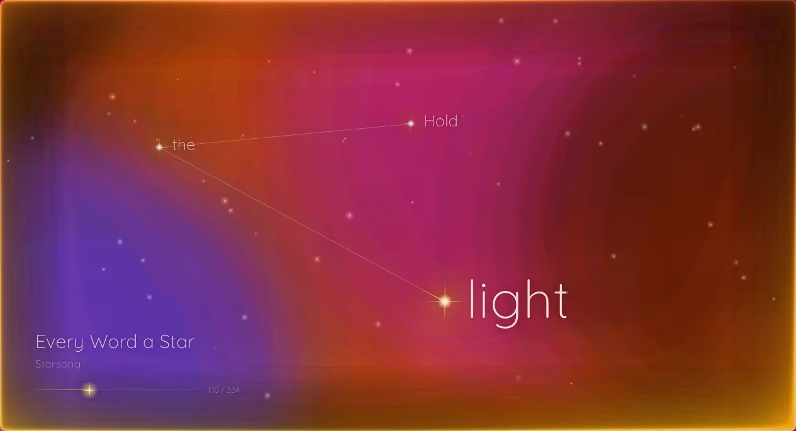
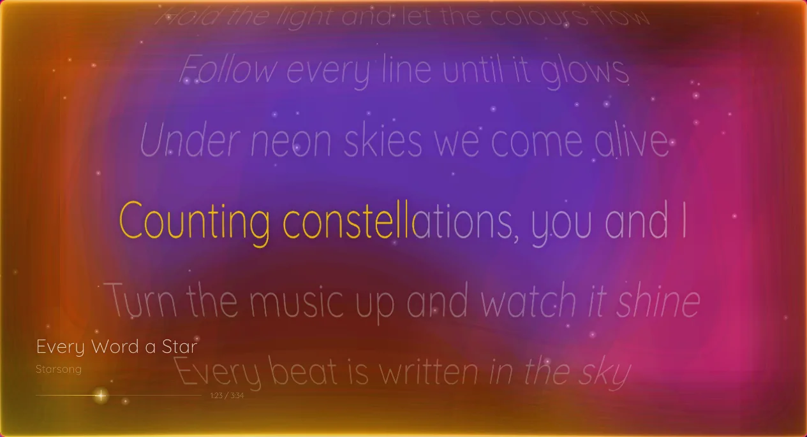
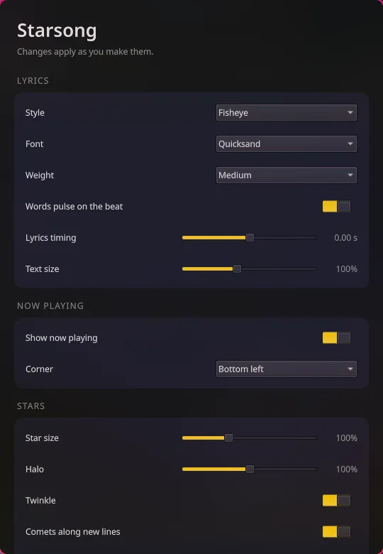

# Starsong



Synced lyrics and music visuals for Windows, in one window. It follows whatever is playing in
Spotify, your browser, or any player that shows up in Windows' media controls.

- **Lyrics**, synced word by word from [LRCLIB](https://lrclib.net), in four styles:
  - *constellation* (default): each word becomes a star as it is sung, joined to the previous
    word. The word being sung shows large.
  - *fisheye*: a stack of lines under a convex lens. The line being sung sits magnified in the
    middle and lights up word by word.
  - *karaoke*: one big line filling word by word, with the previous and next lines around it.
  - *3D wall*: recent lines on a slowly drifting, tilted plane.
- **Album-colour backdrop**: soft blobs in the album's colours drift and blend behind the lyrics.
- **Now playing**: title and artist, with progress as a beam of light with a star at the playhead.
- **Edge glow**: light around the window's edges that pulses with the bass and takes the album's
  colours.
- **Beat-reactive words**: the word or line being sung pulses on each bass hit.



## Install

Download `Starsong.exe` from [Releases](https://github.com/C0deRatoR/starsong/releases) and run it.
Windows 10 (1809 or newer) or Windows 11.

Windows may warn that the app is from an unknown publisher, because the exe isn't code-signed.
Choose **More info → Run anyway**.

## Use

Play music in any app, then open Starsong. Move the mouse to show the **Settings** button.

| Key | Does |
| --- | --- |
| F11 | Full screen on or off (Esc also leaves it) |
| `[` / `]` | Show the lyrics 0.1 s earlier / later, for players that drift |
| N | Next lyric style |
| Ctrl+, | Settings |



Settings show their changes straight away: lyric style, font and size, lyric timing, the backdrop,
the edge glow, and colours (from the album art, a preset, or your own).

Where it keeps things:

- settings: `%APPDATA%\starsong\settings.json`
- lyrics cache: `%LOCALAPPDATA%\starsong\cache`
- log (for bug reports): `%LOCALAPPDATA%\starsong\starsong.log`

To uninstall, delete `Starsong.exe` and those two `starsong` folders.

## Notes

- Lyrics come from [LRCLIB](https://lrclib.net)'s free database. Songs it doesn't have show a
  quiet "No lyrics for this song".
- The beat is read from your default audio output, so the glow pulses with anything that is
  playing, not only the track shown.
- `starsong.py --demo` (or `Starsong.exe --demo`) plays a stand-in song with its own lyrics and
  beat, with no music needed. The screenshots were taken this way.

## Run from source or build the exe

You need [uv](https://docs.astral.sh/uv/).

```powershell
git clone https://github.com/C0deRatoR/starsong
cd starsong
uv run starsong.py                    # run it
uv run python -m unittest             # tests
uv run pyinstaller Starsong.spec      # build dist\Starsong.exe
```

`--demo` also runs on Linux or macOS, which helps when working on the visuals.

## How it works

| File | Job |
| --- | --- |
| `starsong.py` | Starts the app, logs, and looks up lyrics in the background |
| `media.py` | Reads the playing track, its position and the album art's colours from Windows' media controls |
| `audio.py` | Bass level from the default output (WASAPI loopback), for the beat |
| `settings.py` | Loads and saves the settings file |
| `fetch_lyrics.py` | LRCLIB lookup. Uses real word timings when LRCLIB has them, otherwise spreads a line's time over its words. Caches results |
| `qml/Main.qml` | The window, its keys and the settings button |
| `qml/Core.qml` | The current line, colours and beat that every view reads |
| `qml/Settings.qml` | Every setting and its default |
| `qml/SettingsWindow.qml` | The settings window |
| `qml/LyricsScene.qml` | Backdrop + selected style + now playing |
| `qml/Backdrop.qml` | Drifting album-colour background |
| `qml/Constellation.qml`, `Fisheye.qml` (+ `shaders/lens.frag`), `Karaoke.qml`, `Wall.qml`, `Word.qml` | The lyric styles |
| `qml/NowPlaying.qml` | Title, artist and the progress beam |
| `qml/Glow.qml` + `shaders/glow.frag` | Edge glow |
| `qml/Demo.qml` | Stand-in player for demo mode |
| `Starsong.spec` | PyInstaller build of `Starsong.exe` |

After editing a shader, rebuild it with Qt's `qsb`, e.g.
`qsb --qt6 -o qml/shaders/glow.frag.qsb qml/shaders/glow.frag`

## License

GPL-3.0-or-later, see `LICENSE`. The bundled Quicksand font is under the SIL Open Font License
1.1, see `qml/fonts/OFL.txt`.
